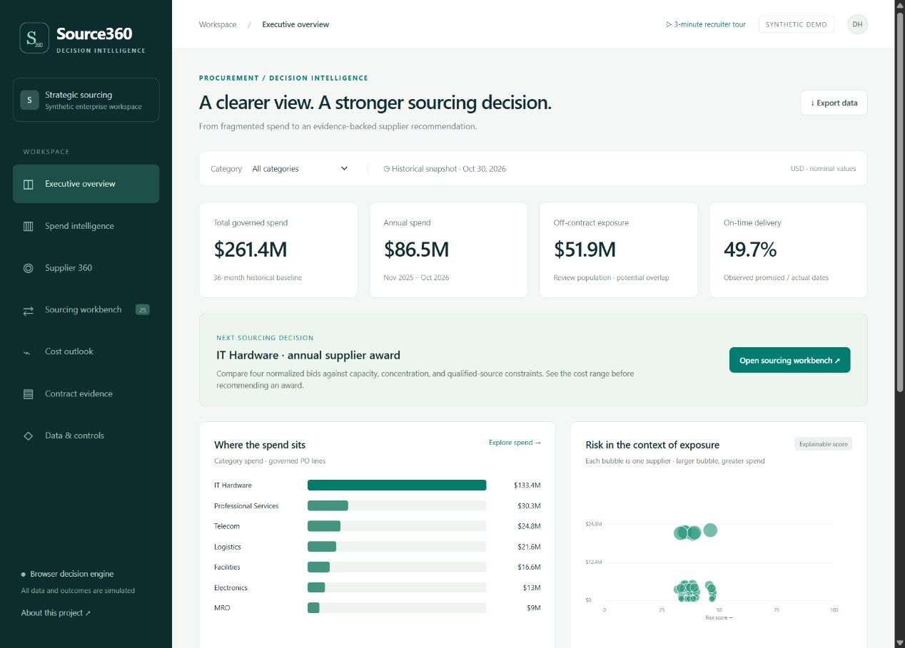
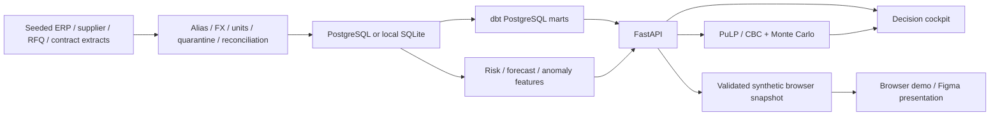

# Source360 AI

A procurement decision platform that reconciles purchase orders and invoices, compares supplier bids, and solves 25 sourcing events together under shared capacity limits. Built by Daniyal Hayat. **All records, contracts, prices, and savings are synthetic. No realized client impact is claimed.**

The browser edition uses a validated snapshot derived from 100,000 synthetic purchase-order lines. Follow the three-minute tour from spend diagnostics and supplier risk through award comparisons, cost forecasts, and source evidence.

[Browser demo](https://daniyalhayat.github.io/demos/source360/) · [Figma presentation](https://www.figma.com/make/vVtgALgGrzPlLmAHllHJzV) · [Earlier published Figma version](https://procurement-strategic-intelligence-daniyalhayat.figma.site)



## Open the application

Double-click **Start Source360.cmd** on Windows. This starts the local FastAPI application at `http://127.0.0.1:8765`. Keep the launch window open. Python 3.11-3.13 is required on a fresh machine; first-time dependency installation requires internet access. The supplied local dataset also works offline after installation.

For PostgreSQL and governed dbt marts:

```sh
docker compose up -d --build
```

The pipeline generates 100,000 PO lines, reconciles sources, loads PostgreSQL, builds/tests dbt marts, then releases the application on port 8765. Stop a previously running local app before using the same port. Database exposure is limited to localhost. The example database password is for disposable local synthetic data only.

## Reproduce and test

```sh
python -m venv .venv
```

Activate the environment (`.venv\Scripts\Activate.ps1` on Windows, `source .venv/bin/activate` on Linux/macOS), then:

```sh
pip install -r requirements-dev.txt
python -m source360.generate --rows 100000 --seed 360
python -m source360.pipeline
pytest -q
npm ci
npm run vendor
python -m source360.portfolio
python -m source360.export_demo
npm test
python -m uvicorn source360.api:app --host 127.0.0.1 --port 8765
```

`dist/` is the portable browser edition. The existing individual-event optimizer uses subset/LP-vertex enumeration, with fifty cross-engine cases against Python. The new **Portfolio sourcing** page solves all 25 events together using pinned HiGHS WebAssembly in a background worker, with an independent PuLP/CBC comparison. It checks demand, shared capacities, qualification, concentration and supplier counts before displaying results. Change capacity to 10% to see an infeasible scenario with savings withheld. Public scenarios stay in the visitor's session and can be downloaded as receipts.

## What is implemented

- Seeded generator: 100,000 PO lines, 85,425 raw invoice rows, 60 suppliers, 10 categories, 25 RFQs / 100 bids, 120 contract snippets, 3,000 communications, 60 monthly market-index observations per category.
- Explicit aliases, fixed synthetic FX, unit conversion, impossible-value quarantine, duplicate invoice detection, signed source-to-target financial bridge, publication checks, raw-file SHA-256 validation.
- Typed relational facts and dimensions with primary/foreign keys, checks and query indexes; transactional snapshot upserts, late corrections and deletion logs; PostgreSQL writer serialization and replay protection. Immutable monthly Parquet snapshots use Zstandard compression and SHA-256 manifests. The warehouse publication and review priorities appear in the application.
- Spend concentration, off-contract exposure, robust item-price anomalies, transparent supplier risk components and observed-delivery denominators.
- Six-month nominal-spend forecast, ETS versus seasonal-naive model selection, six rolling one-step backtests and labeled illustrative prediction bands.
- Capacity/concentration/source-count/qualification constrained supplier allocation, three presets, demand sensitivity API, 5,000-draw cost simulation, objective and cash-cost reconciliation, input hashes and review receipts.
- Source-linked commercial-term extraction with a 50-field golden set, plus MiniLM semantic retrieval and FLAN-T5 generation with exact source offsets and human review. Five local synthetic assistant questions passed retrieval and answer checks; this small benchmark does not establish production accuracy. Public pages replay these actual model runs; new questions run through the local API.
- FastAPI contract and exports; native web interface and shareable browser edition; PostgreSQL/dbt path; executed Airflow DAG, four-tool MCP client integration and local PySpark parity verification.
- Native Power BI project with embedded synthetic data, reproducible report generation, supplier performance, sourcing allocation, forecast and financial-control pages.
- Real AWS S3 upload/download verification in us-east-2 with encryption, public-access blocking, versioning, checksum validation and confirmed cleanup. CloudFormation template and verification script are included.

## Architecture



The static public edition carries the same validated data and decision equations without exposing a database or requiring a running laptop. It is a portfolio demonstration, not an operational procurement service. The backend uses SQLite for zero-setup local use and PostgreSQL with independently recomputed dbt marts in Compose. See [architecture](docs/architecture.md), [metrics](docs/metric_dictionary.md), [model cards](docs/model_cards.md), and [verification](docs/verification.md).

## Recruiter walkthrough

Use **3-minute recruiter tour** in the top bar. Review source reconciliation, run the balanced IT Hardware award, compare strategies, adjust demand, inspect source contract evidence, then explore forecast validation. Savings are modeled against the RFQ reference price at equivalent demand, never presented as realized savings.

## Boundaries

Figma and the public browser app are the presentation surfaces. The local API supports new AI questions after installing `requirements-extensions.txt`; first use downloads the model weights. Airflow was executed as a real three-task DAG test, not left as an always-running scheduler. PySpark was executed locally, not on a hosted Databricks cluster. AWS verification deployed disposable private S3 resources and removed them; it does not host the public application. No external supplier communications or award actions exist. See `docs/verification.md` for execution receipts and reproduction commands.

## November 4 implementation and validation

Run `python -m source360.portfolio` after ingestion to reproduce the joint 25-event scenario: **$54.81M reference baseline, $46.54M landed cash cost and $8.27M modeled savings (15.08%)**. This supersedes the earlier independent-event aggregate. RFQs are non-overlapping renewal lots for FY2027. Supplier capacity is shared within each period/unit pair, using observed peak trailing-year quarterly throughput × 4. Demand uses observed year-over-year purchase growth bounded to 0.90–1.15; the baseline uses weighted trailing-year paid prices. Capacity and demand remain declared synthetic planning proxies; other customers' commitments, negotiated availability and realized savings are unknown. Risk-adjusted objective value is reported separately from cash cost.

The 100,000-line run published 99,816 accepted facts into a real PostgreSQL database and verified all 36 Parquet partitions. Five correction/replay/rollback/corruption checks passed on both SQLite and PostgreSQL. See [warehouse evidence](docs/warehouse-verification.json) and [joint-solver evidence](docs/portfolio-evaluation.json). There are 56 Python checks and three additional browser-solver checks. The native Power BI project includes the joint portfolio, shared capacity and off-contract review pages. Source360 remains locally reproducible and statically shareable, without a paid always-on database.

Warehouse ingestion accepts complete source snapshots, not partial CDC batches. Missing keys create deletion log entries. A previously superseded snapshot cannot silently replace current state; a deliberate correction needs a new source revision. Only database-committed manifests are published. A failed transaction may leave an unreferenced immutable lake directory, which is excluded from the publication receipt. The Parquet store is a local analytical lake, not a claim of distributed lakehouse scale.
