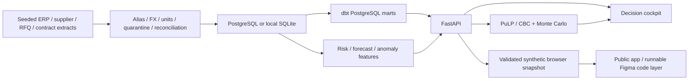

# Source360 AI

An auditable procurement decision platform, from messy source extracts to a constrained supplier award. Built by Daniyal Hayat. **All records, contracts, prices, and savings are synthetic. No realized client impact is claimed.**

The recruiter demo includes a guided three-minute tour, spend diagnostics, supplier scorecards, a working sourcing optimizer, three-strategy comparison, cost forecasts, source evidence, and financial controls. No account or installation is required for the public demo.

## Open the application

Double-click **Start Source360.cmd** on Windows. This starts the local FastAPI application at `http://127.0.0.1:8765`. Keep the launch window open. Python 3.11-3.13 is required on a fresh machine; first-time dependency installation requires internet access. The supplied local dataset also works offline after installation.

For PostgreSQL and governed dbt marts:

```sh
docker compose up -d --build
```

The pipeline generates 100,000 PO lines, reconciles sources, loads PostgreSQL, builds/tests dbt marts, then releases the application on port 8765. Stop a previously running local app before using the same port. Database exposure is limited to localhost. The example database password is for disposable local synthetic data only.

## Reproduce and test

```sh
python -m venv .venv
```

Activate the environment (`.venv\Scripts\Activate.ps1` on Windows, `source .venv/bin/activate` on Linux/macOS), then:

```sh
pip install -r requirements-dev.txt
python -m source360.generate --rows 100000 --seed 360
python -m source360.pipeline
pytest -q
python -m source360.export_demo
python -m uvicorn source360.api:app --host 127.0.0.1 --port 8765
```

`dist/` is the portable browser edition. It contains an immutable synthetic analytical snapshot and an exact specialized optimizer using subset/LP-vertex enumeration. The Python API uses PuLP/CBC. Fifty cross-engine cases test identical optimal objective values and cash costs. Monte Carlo generators are deterministic within each implementation but do not produce identical draws across Python and JavaScript. Public scenarios stay in the visitor's session and can be downloaded as receipts; there is no central public scenario database.

## What is implemented

- Seeded generator: 100,000 PO lines, 85,425 raw invoice rows, 60 suppliers, 10 categories, 25 RFQs / 100 bids, 120 contract snippets, 3,000 communications, 60 monthly market-index observations per category.
- Explicit aliases, fixed synthetic FX, unit conversion, impossible-value quarantine, duplicate invoice detection, signed source-to-target financial bridge, publication checks, raw-file SHA-256 validation.
- Spend concentration, off-contract exposure, robust item-price anomalies, transparent supplier risk components and observed-delivery denominators.
- Six-month nominal-spend forecast, ETS versus seasonal-naive model selection, six rolling one-step backtests and labeled illustrative prediction bands.
- Capacity/concentration/source-count/qualification constrained supplier allocation, three presets, demand sensitivity API, 5,000-draw cost simulation, objective and cash-cost reconciliation, input hashes and review receipts.
- Deterministic source-linked commercial-term extraction and a 50-field golden set. No language model, embeddings, or autonomous award authority are claimed.
- FastAPI contract and exports; native web interface and shareable browser edition; PostgreSQL/dbt path; optional Airflow DAG, read-only MCP adapter and PySpark transform.

## Architecture



The static public edition carries the same validated data and decision equations without exposing a database or requiring a running laptop. It is a portfolio demonstration, not an operational procurement service. The backend uses SQLite for zero-setup local use and PostgreSQL with independently recomputed dbt marts in Compose. See [architecture](docs/architecture.md), [metrics](docs/metric_dictionary.md), [model cards](docs/model_cards.md), and [verification](docs/verification.md).

## Recruiter walkthrough

Use **3-minute recruiter tour** in the top bar. Review source reconciliation, run the balanced IT Hardware award, compare strategies, adjust demand, inspect source contract evidence, then explore forecast validation. Savings are modeled against the RFQ reference price at equivalent demand, never presented as realized savings.

## Boundaries

The user requested Figma and recruiter-facing publication as the main presentation surface. `powerbi/` therefore contains an import/query/measure/theme authoring kit; no native `.pbix` is claimed. AWS S3 is an optional architecture deployment, not a billing or credential dependency. Airflow/MCP/PySpark extension verification is explicitly tracked in `docs/verification.md`. No external supplier communications or award actions exist.
